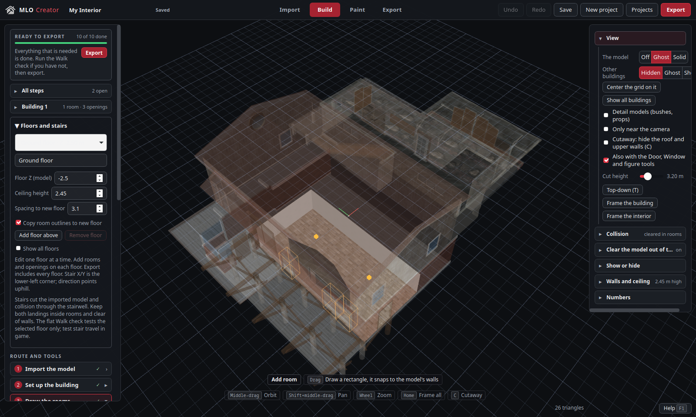
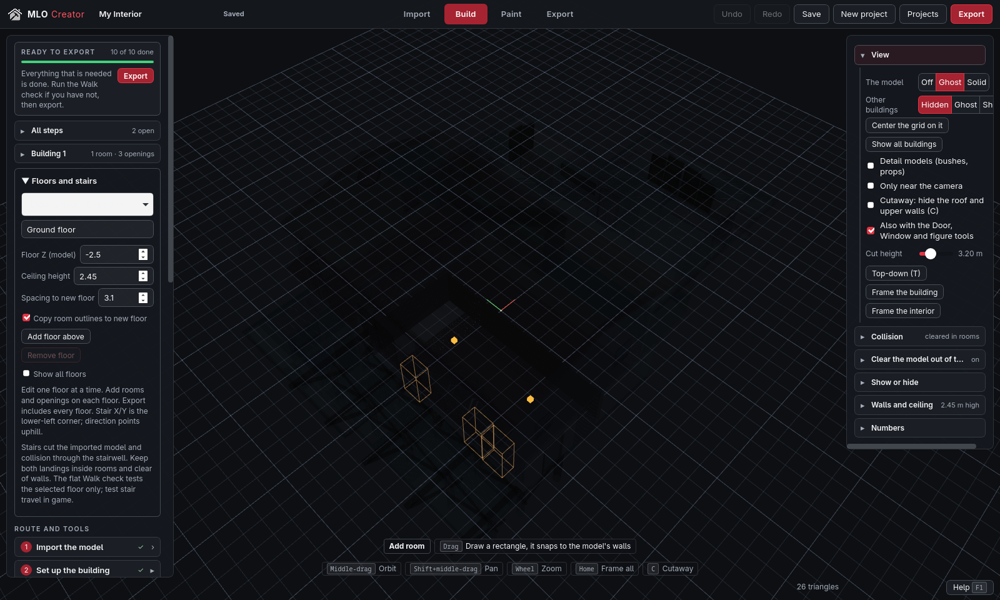
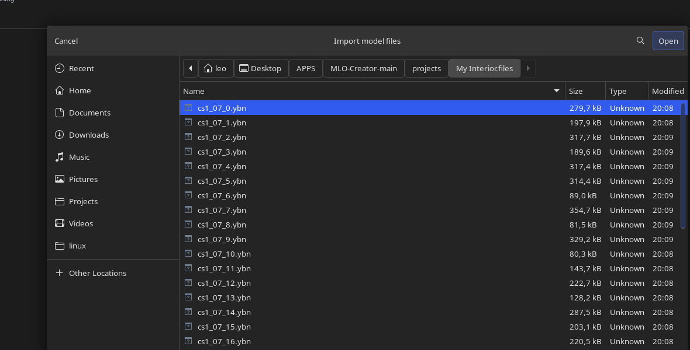

# MLO Creator — Linux

A complete native Linux port of MLO Creator, the program in the source tree's [`source/`](../source) folder
that builds FiveM interiors (MLOs) inside an existing GTA V building. This build also ports the feature
set of the modified/rebuilt editor supplied in `other-sources/MLO-Creator-main1`: multiple storeys,
half/quarter walls, face painting, the 1,200-image wall/floor library, the full window/door/frame/garage
library, furniture and signs, the new exporter rules and the Crimtopia UI theme.

It is a native application, not Wine: a GTK 3 / WebKit2GTK window (no WebView2), a .NET 9 host running
CodeWalker.Core on Linux, and the editor files in [`ui/`](ui). It runs on **both X11 and Wayland**.



*The rebuilt editor under X11: the imported Paleto house, the new Floors and stairs panel, the Crimtopia
theme and the same editor toolbar.*



*The same page under Wayland (the screenshots are page snapshots, so they show exactly what the editor
draws).*



*The native GTK file chooser used to import model files.*

## What works

Everything the modified build documents in [`docs/MODIFIED-BUILD.md`](docs/MODIFIED-BUILD.md) and
[`docs/HOW-IT-WORKS.md`](docs/HOW-IT-WORKS.md), now on Linux:

- **Multi-storey buildings:** adjustable spacing between floors, add/remove floors above with optional
  room-outline copying, floor Z in the model frame, show-all-floors preview, stairs with landings,
  step meshes and collision, floor/ceiling openings for stairwells, and links to the imported model's
  collision and wall faces on upper floors. All floors of a building are exported into its one interior.
- **Flexible walls:** full, half and quarter-height walls in **Wall** (whole new building) and
  **Partition** (imported buildings), with capped tops, matching collision and opening clipping.
- **Face texturing:** paint one whole flat wall side in a click; it stops at corners, room dividers and
  height changes, and shared walls keep independent paper on their two sides.
- **Faster painting:** drag-area painting, whole-floor and whole-ceiling fills, 600 added wall images,
  600 added floor images, colour/tile/finishing controls, and texture seam/colour finishing.
- **Doors and windows:** the full `.glb` library in both builders, tighter openings with 6 mm reveals,
  frames around doors, doors in frames, double doors, left/right hinges, reverse facing, clean opening
  cuts that clear the backing model and collision, and up-and-over **garage doors** with a generated
  OneSync client/server controller.
- **Adjustable archways:** width, height and sideways position.
- **Faster editing:** drag-and-snap, multi-select, stale-preview guards, immediate face-deletion
  feedback, and cleaner cuts across materials.
- **Furnishing:** 36 static furniture/decor items (sofas, tables, bar tables, counters, beds, shelves,
  plants, signs, ...), two-part finishes, rotated per-part collision, multi-select group transforms,
  snapping to floor/furniture tops/walls, and **editable text signs** with seven font styles and
  preview/export pixel equality.
- **Easier setup:** archetype override for model lookup, alternative door anchors and vector4 placement.
- **Exporter fixes:** portal fragments joined into openings, a 96-exterior-portal guard before touching
  an existing export, exterior room-0 meshes placed as world YMAP entities, corrected vertex lighting,
  the manifest registering each interior once, output-folder handling and persistent validation messages.
- **Polish:** grass removal support, the Crimtopia charcoal/crimson/amber theme, undo/redo and save/load
  for the new tools.

## Requirements

- 64-bit Linux with a desktop (X11 or Wayland).
- **GTK 3** and **WebKit2GTK 4.1**.
- **.NET 9** to build and run the framework-dependent build. The packaged self-contained build includes
  the runtime.
- A copy of **GTA V (Legacy edition)** and CodeWalker to extract the game files, as described in the
  [original README](../source/README.md).
- About 400 MB for the editor's 1,200-image wall/floor library; the unpacked self-contained package is
  about 0.5 GB. Keep the `ui`, `models` and executable folders together: the texture library, the
  garage panel and the `ui/runtime` Lua templates are part of the program.

Install the build dependencies:

```bash
# Arch / CachyOS / Manjaro
sudo pacman -S dotnet-sdk gtk3 webkit2gtk-4.1 pkgconf

# Debian / Ubuntu (24.04+)
sudo apt install dotnet-sdk-9.0 libgtk-3-dev libwebkit2gtk-4.1-dev pkg-config

# Fedora
sudo dnf install dotnet-sdk-9.0 gtk3-devel webkit2gtk4.1-devel pkgconf
```

The runtime libraries alone are enough for the packaged build: `gtk3` and `webkit2gtk-4.1` on Arch,
`libgtk-3-0` and `libwebkit2gtk-4.1-0` on Debian/Ubuntu.

## Build and run

**Before building** make sure you copy the textures from another build of the app (under ui/tex) or get them from this [Google Drive](https://drive.google.com/file/d/1_QEEl36xFRFxTR7nMO3wDrNnISQmINIz/view?usp=sharing) and put them in linux/ui/tex

```bash
cd linux
./build.sh          # .NET host + native window; copies the editor and its textures
./run.sh            # start it (X11 or Wayland)
```

`run.sh` builds first when the output is missing, then starts the program. It takes the same arguments
as the Windows program (`--port`, `--browser`, `--devtools`, `--no-window`, `--start`, `--grab`,
`--root`, ...).

Make a self-contained folder and zip that runs without .NET:

```bash
./package.sh        # -> dist/MloCreator/ and dist/MloCreator-linux-x64.zip
./install.sh        # install into ~/.local (application menu entry, ~/.local/bin/mlo-creator)
```

`install.sh` copies the program to `~/.local/share/mlo-creator` (including the full `ui` texture library),
creates `~/.local/bin/mlo-creator`, adds `mlo-creator.desktop` and the icon. It needs no root.

### Where the program keeps its files

As before, projects, cache, exports and `settings.json` live next to the program when that folder is
writable; when the program is installed in a read-only place it uses `$XDG_DATA_HOME/MloCreator`
(`~/.local/share/MloCreator`). Use `--root DIR` to choose explicitly.

`settings.json`, `GTA5_PATH`, the Steam/GTA detection and the Wine-path conversion from the first Linux
port still apply. The **Legacy edition** folder is the one to point at (`GTA5.exe`).

## How the Linux port is built

| Windows (modified build) | Linux port |
|---|---|
| WinForms + WebView2 window | `native/mlo-shell.c`: a GTK 3 window with a WebKit2GTK view; also the GTK file/folder picker. It is a separate process with its own main loop; the .NET host starts it and waits. |
| .NET Framework 4.8 + `csc.exe` | .NET 9 SDK project (`src/MloCreator.csproj`), `dotnet build` / `dotnet publish`. |
| CodeWalker Windows DLLs | the exact `CodeWalker.Core.dll`, `SharpDX.dll` and `SharpDX.Mathematics.dll` from the modified Windows build, kept in [`lib/`](lib) (netstandard2.0). |
| `GTA5Keys.LoadFromPath` | `src/GameKeys.cs`: reads `GTA5.exe`, finds the AES key, unlocks CodeWalker's NG keys/LUT. |
| `JavaScriptSerializer` | `src/Compat/Json.cs` on `System.Text.Json`. |
| `System.Drawing` | StbImageSharp + a small PNG encoder (`src/Compat/ImageUtil.cs`). |
| WinForms dialogs, registry, `explorer.exe` | GTK native chooser; Steam/GTA detection; `xdg-open`; XDG paths (`src/Linux.cs`). |
| The modified editor in `source/ui` and its textures | Ported to [`ui/`](ui): all modified JS/HTML/CSS, the 1,200-image PNG library, `runtime/garage-*.lua`, `gridmodels.js`, `props.js`, `proptransforms.js`, `storeys.js`, `texture-catalog.js` and the Crimtopia theme. The old Windows page stays in `source/ui`. |
| Modified `.glb` library | [`models/`](models): the three original models plus the MIT up-and-over garage panel. |

The C# changes from the modified build were merged into `src/Exporter.cs`, `src/FitExport.cs`,
`src/GlbModels.cs` and the new `src/GarageExport.cs`, while keeping the Linux-only replacements above
(especially the StbImageSharp texture decoding). The rest of the host (`Program`, `ImportHost`,
`ModelCut`, `CollisionCut`, `Vanilla`, `HouseFit`, `Patcher`, `Dds`) is the same as the first Linux port.

### Collision parity with the Windows export

The first Linux build referenced CodeWalker.Core 1.0.3 from NuGet. That build writes the collision
resource with a different material/vertex order; for the “Try House” project it produced **1,108
triangles that did not match the Windows export**, so the game’s bounds BVH did not cover the walls and
furniture correctly (invisible wall holes, furniture collision not working).

The port now uses the exact CodeWalker/SharpDX DLLs that the modified Windows application uses, from
`lib/`. With them the exported `q3_mlo.ybn` has the same 2,556 collision triangles, the same
material/room assignment and full BVH coverage as the Windows export; the visual triangles of
`q3_int.ydr`, `q3_ext.ydr` and the door `.ydr` files also match. **Re-export existing resources with this
build** (or install the packaged build) so the old collision files are replaced.

The X11/Wayland choice is made by GTK. Set `GDK_BACKEND=x11` or `GDK_BACKEND=wayland` to force one; the
port logs which backend it used in `logs/window.log`.

### The native window

`native/mlo-shell.c` does:

- one 1600×960 GTK window, title `MLO Creator`, window icon from `ui/logo.png`, size memory in
  `cache/window/window.txt`;
- WebKit settings: WebGL on, hardware acceleration, console messages to stdout, clipboard access,
  no browser context menu, no page zoom/reload/back-forward keys (F12 opens the inspector only with
  `--devtools`);
- it refuses navigation away from the editor and blocks new windows;
- on close it asks the page to save (`MLO.Model.save()`), gives it a moment, then closes; the host waits
  for a running export to finish before exiting;
- it exits if the host process disappears (`--parent`);
- page snapshots (`--screenshot`) work on both X11 and Wayland through WebKit's snapshot API.

### Developer hooks

```bash
mlo-shell --url URL --eval-file script.js [--eval-exit]       # run a JS body, print MLO_EVAL_RESULT
mlo-shell --url URL --screenshot out.png [--screenshot-exit]  # save the page as a PNG (X11 + Wayland)
mlo-shell --url URL --close-after 12                          # close the window as the user would
mlo-shell --url URL --devtools                                # WebKit inspector (F12)
```

The host has `--debug-api` (writes the last `/api/export` request to `logs/export-payload.json`) and
`--no-window` (server only, for curl/automation). `--dev` fixes the API token to `dev`.

## Verification done

- The Linux port builds cleanly (C# + the native shell), runs without .NET from the self-contained
  package, and the real project `projects/My Interior.mlo.json` opens in the rebuilt editor.
- Both backends: the shell logged `display X11 (:0)` and `display Wayland (wayland-1)`, loaded the page,
  opened the project (3 models, 16 textures) and produced the page snapshots above. WebGL 2.0 was probed
  in the first port; the rebuilt page uses the same renderer.
- **Upstream tests:** the modified build's non-browser test suite (editor, floors/storeys, grid models,
  furniture, props, transforms, archways, paint faces, texture finishing) was run against `linux/ui`:
  **69 passed, 1 skipped** (the skipped one needs a wooden-door fixture). This covers the new geometry,
  save/load, undo/redo, collision and export payloads.
- **Texture library:** `MLO.texturePhotos.length` is 1,200; a catalog PNG is served (HTTP 200, 389 KB);
  the Paint tab shows Added floors/Added walls.
- **Collision parity:** the “Try House” grid project was exported on Linux and compared with the same
  project exported by the Windows application. With the Windows CodeWalker/SharpDX DLLs the canonical
  collision set is identical (2,556 triangles, material/room counts, winding), and the BVH has full
  coverage (1,601 nodes, 801 leaves, 19 trees). The old NuGet CodeWalker build had **1,108 differing
  triangles**, which explains the in-game holes/furniture collision. The visual meshes (`q3_int.ydr`,
  `q3_ext.ydr`, `q3_fd1.ydr`) also match triangle for triangle.
- **Real export:** the project exported with the new exporter to `output/mlo_paleto`. CodeWalker re-opened
  every file: the interior `.ydr` (26 triangles, 2 textures), the MLO `.ytyp` (2 rooms, 3 portals,
  1 entity), the placement YMAP with `numExitPortals=3`, and the cut building model/collision. The
  `fxmanifest.lua` no longer double-registers the interior with `DLC_ITYP_REQUEST`.
- **Garage doors:** a test building with the bundled up-and-over panel exported `gd1.ydr` (72 triangles,
  box collision), `garage_config.lua`, `client/garages.lua`, `server/garages.lua`, the OneSync
  dependency and the garage README section.
- **Exterior/portals:** a test with two touching portal fragments and a room-0 group merged the fragments
  into one opening, put the exterior mesh in the YMAP as a world entity and recorded one exit portal.
- **File dialog, save-on-close, packaged app:** the GTK picker opens; closing the window saves the
  project; the self-contained package starts and exports without a .NET installation.

Still to be seen in the game, exactly as the modified build says: GTA's streaming, lighting, portals,
collision, door/garage movement, furniture appearance and sign pixels. Export the resource, install it,
restart the map, reconnect clients and test on both sides. Garage doors additionally need OneSync and the
included controller; the editor cannot validate the game's player/vehicle controller.

## Limits

- One interior room plus the outside room per building; all floors share that room. This does not add
  separate GTA room IDs, sound isolation or visibility portals between storeys.
- The two-room exporter supports at most **96 exterior portals after joining fragments** (the guard from
  the modified build). Split the project into buildings if it triggers.
- The imported model and its collision are cut by the openings; the editor still cannot test the game's
  streaming, lighting, portal culling or door/garage controller.
- The garage controller requires OneSync; it moves a client-side panel and its collision, with
  server-side proximity/bucket/ACE checks. Test it with players and vehicles in-game.
- Signs use installed system fonts through the browser canvas; the exported texture is fixed, but a
  project opened on another machine may preview a fallback font before export.
- The **Enhanced edition** of GTA V is not supported by this CodeWalker version; use the Legacy folder.
- The added `smdz_*` wall/floor photographs are supplied with the modified build, not generated by MLO
  Creator. They are not covered by the MIT licence; check their terms before redistributing them.
- The Windows build in `../source` is untouched. `linux/ui` is the ported editor; the old page remains in
  `source/ui` for the Windows build.

## Layout

| Path | Content |
|---|---|
| `src/Program.cs` | local server, routes, settings, game detection, window start |
| `src/AppWindow.cs` | starts the native window and the fallback browser |
| `src/Linux.cs` | Linux paths, Steam/GTA detection, GTK dialogs, `xdg-open`, browser fallback |
| `src/GameKeys.cs` | CodeWalker keys from `GTA5.exe` on Linux |
| `src/ImportHost.cs`, `ModelCut.cs`, `CollisionCut.cs` | import, cutting |
| `src/Vanilla.cs`, `HouseFit.cs`, `Patcher.cs` | game file lookups and the vanilla house workflow |
| `src/Exporter.cs`, `FitExport.cs`, `GarageExport.cs` | resource, fitted door/window/garage props, ports |
| `src/GlbModels.cs`, `Dds.cs` | `.glb` reading and DDS writing |
| `src/Compat/Json.cs`, `Compat/ImageUtil.cs` | `JavaScriptSerializer` and `System.Drawing` replacements |
| `native/mlo-shell.c` | GTK 3 + WebKit2GTK window and file dialogs |
| `ui/` | the rebuilt editor (all modified JS/HTML/CSS, 1,200 PNG textures, garage Lua runtime) |
| `models/` | the four bundled `.glb` models and their credits |
| `docs/` | the modified feature documentation and how-it-works |
| `desktop/`, `build.sh`, `run.sh`, `package.sh`, `install.sh` | desktop entry and build/run/package/install |
| `tests/` | the manual page/eval checks used while porting |

## Credits and licences

MLO Creator's own code is MIT ([`../source/LICENSE`](../source/LICENSE)). The Linux port adds:

- **StbImageSharp** (public domain) for `.glb` pictures.
- **GTK 3** (LGPL-2.1) and **WebKitGTK** (LGPL-2.1 / BSD) — system libraries.
- **.NET 9** (MIT) — included in the self-contained package.
- **CodeWalker.Core** / **SharpDX** — the same CodeWalker terms as the Windows build.
- The bundled `.glb` models keep their own licences (one is non-commercial); see
  [`models/CREDITS.txt`](models/CREDITS.txt). The up-and-over garage panel is original MLO Creator
  artwork under MIT.
- The `smdz_*` wall/floor photographs were supplied with the modified build; see the note in **Limits**.

GTA V and its assets belong to Rockstar Games; this project ships none of them.
